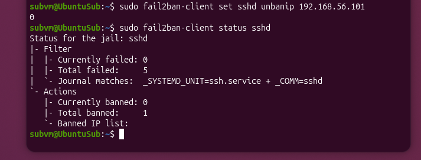
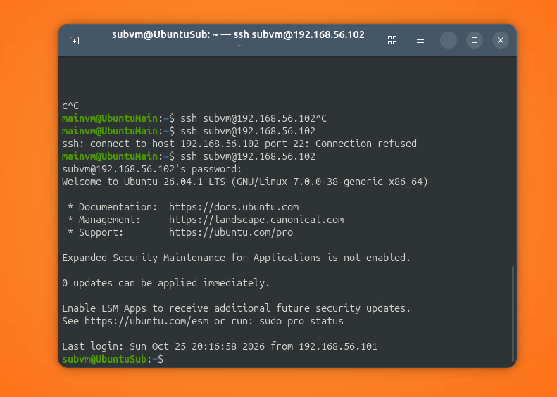

#ssh-failed-logins-lab

Working with failed logins and fail2ban

## Goal
Finding attempts 

## Environment
- Host: Windows 10, VirtualBox 7.2.22
- VM1: Ubuntu 26.04, Hostname: UbuntuMain, username: mainvm, IP 192.168.56.101
- VM2: Ubuntu 26.04, Hostname: UbuntuSub, username: subvm, IP 192.168.56.102
- Network: Host-Only

## Failing password entry
Firstly checking up for ssh stable work


```
sudo ufw status verbose
sudo systemctl status ssh
systemctl status ssh.socket
```
From mainvm looking up for how established connection looks like


```
ssh subvm@192.168.56.102
```

Now attempting to login with wrong password


And looking into new logs on subvm


```
sudo journalctl -u ssh --since "30 min ago" | grep -a "Failed"
```

Those error log lines shows what actually is failed with logging in and which place user was trying to log in to. also IP-address, port, type of connection.

## fail2ban installation and usage
Firstly, installing service and verifying it works properly


```
sudo apt install fail2ban
sudo systemctl enable --now fail2ban
sudo fail2ban-client status sshd
```

Then failed login tries again


And re-checking the fail2ban status 


```
sudo fail2ban-client status sshd
```

Now we see mainvm's IP-address `192.168.56.101`as banned and 5 `Total failed`

## Removing IP-address from banned list
Unbannig mainvm's IP-address and verifying it's no longer in banned list


```
sudo fail2ban-client set sshd unbanip 192.168.56.101
sudo fail2ban-client status sshd
```

And verifying that logging ability is restored



## Problems and conclusions
Problems:
-  any `sudo` command goes straight into auth.log. that also works with commands you are searching with. now, when trying to find 'Failed password' we'll stumble onto ours commands. 
  - to fix, excluding sudo entries with `grep -av "COMMAND="` and searching for exact `Failed password`
- `ssh.service` showed `inactive (dead)`, which looked like SSH was down
  - Explanation: SSH is started on demand by `ssh.socket`, which was `active (listening)` on port 22, so it's actually a common behaviour, but not a problem

Conclusions:
- Failed SSH logins also record source ip, source port, username.
- By default, fail2ban bans certain IP-address for 5 bad password entries.
- When searching for logs, own sudo commands shows up, so filtering is required.

