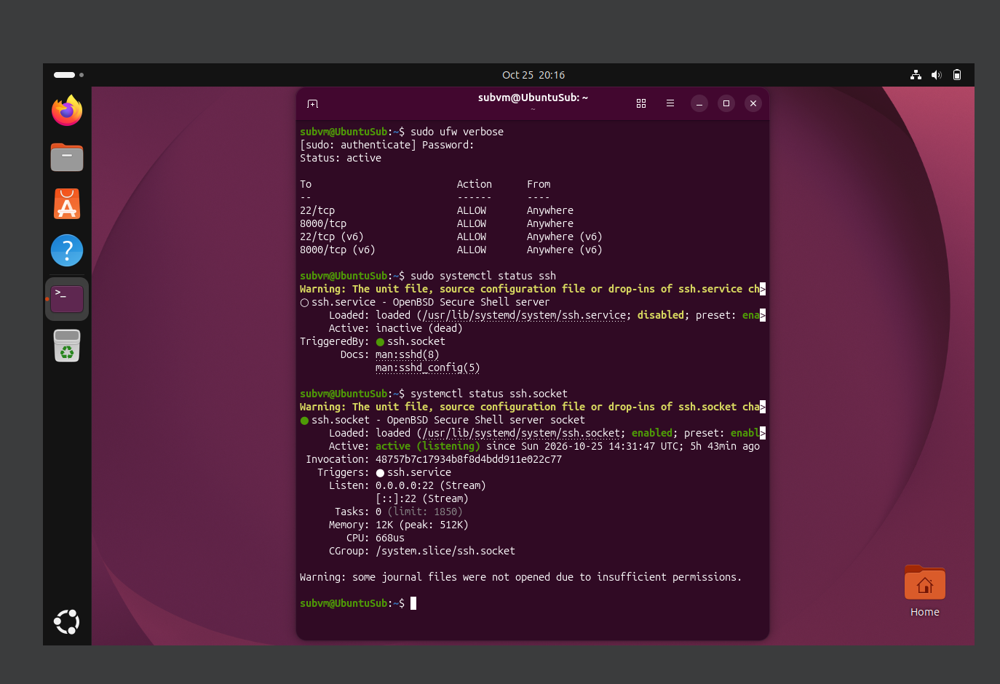
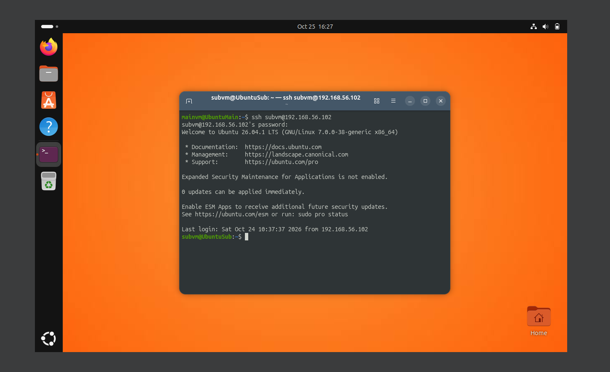
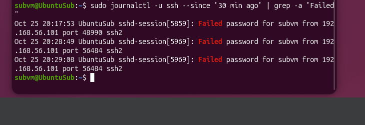
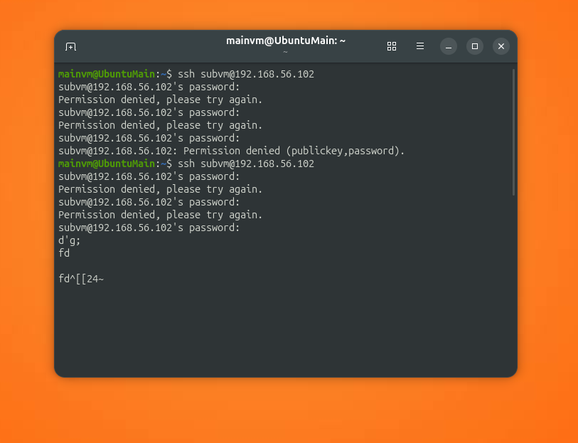

#ssh-failed-logins-lab
Working with failed logins and fail2ban
## Goal
Finding attempts 
## Environment
- Host: Windows 10, VirtualBox 7.2.22
- VM1: Ubuntu 26.04, Hostname: UbuntuMain, username: mainvm, IP 192.168.56.101
- VM2: Ubuntu 26.04, Hostname: UbuntuSub, username: subvm, IP 192.168.56.102
- Network: Host-Only

## Failing password entry
Firstly checking up for ssh stable work


```
sudo ufw verbose
sudo systemctl status ssh
systemctl status ssh.socket
```
From mainvm looking up for how established connection looks like


```
ssh sbvm@192.168.56.102
```
Now attempting to login with wrong password


And looking into new logs on subvm


```
sudo journalctl -u ssh --since "30 min ago" | grep -a "Failed"
```
Those error log lines shows what actually is failed with logging in and which place user was trying to log in to. also IP-address, port, type of connection.

## fail2ban installation and usage
Firstly, installing service and verifying it works properly


```
sudo apt install fail2ban
sudo systemctl enable --now fail2ban
sudo fail2ban-client status sshd
```
Then failed login tries again



And re-checking the log 


```
sudo fail2ban-client status sshd
```

Now we see mainvm's IP-adress `192.168.56.101`as banned and 5 `Total failed`
##
##

## Problems and conclusions
Problems:

Conclusions:
- any `sudo` command goes straight into auth.log. that also works with with commands you are searching with. now, when trying to find 'Failed password' we'll stumble onto our's commands. 
